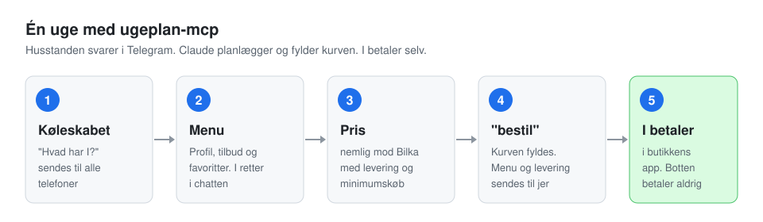
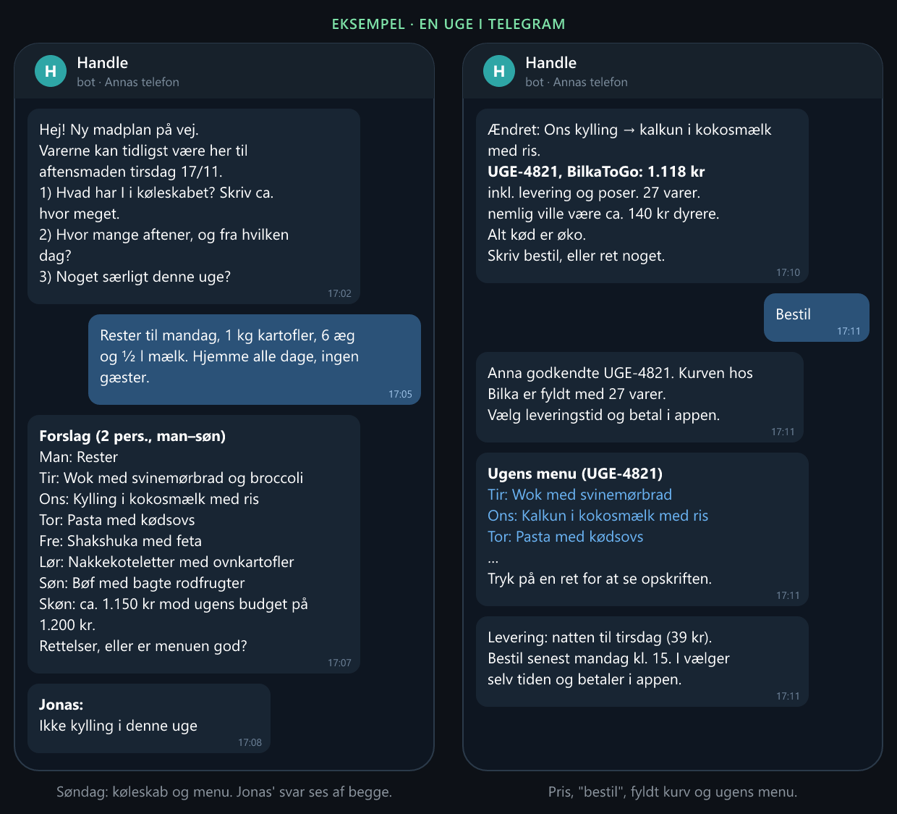

# ugeplan-mcp

**Ugens madplan for hele husstanden, direkte på telefonen. Din AI-assistent laver planen, I retter den i Telegram, og kurven bliver fyldt hos nemlig.com eller BilkaToGo. I betaler selv.**

[](https://github.com/JuliusTorpLarsenPrivat/ugeplan-mcp/actions/workflows/ci.yml)
[](LICENSE)




> **Den kan aldrig bestille eller betale.** Den kode findes ikke, en vagt blokerer kaldene, og testene fejler, hvis nogen prøver at tilføje dem.

## Sådan ser en uge ud

1. **Søndag:** I skriver "lav madplan" til jeres AI-assistent. Botten spørger på begge jeres telefoner: *"Hvad har I i køleskabet?"* I svarer, som det passer jer, også indtalt.
2. **Menu:** Assistenten laver en menu ud fra jeres profil, det I har hjemme, ugens tilbud og jeres favoritretter, med et prisskøn mod ugens budget. I retter i Telegram ("ikke fisk tirsdag", "billigere").
3. **Pris:** Hele listen prissættes i begge butikker, med levering, poser og minimumskøb. Den billigste vinder, eller begge, hvis det kan betale sig.
4. **"bestil":** Kurven bliver fyldt med præcis de godkendte varer. Botten sender ugens menu med links til opskrifterne og fastgør den øverst i chatten. Den sender også den billigste leveringstid, der når første aftensmad, og hvornår I senest skal bestille.
5. **I betaler** i butikkens app.

I kan se hinandens svar, og I behøver ikke vente på hinanden.



<sub>Eksempel med opdigtede navne og priser. Teksterne er dem, botten sender.</sub>

## Det, der adskiller den

- **Hele husstanden på Telegram.** Flere telefoner, svar ses af alle, gratis og uden AI-udgifter i botten.
- **Den husker jeres hjem.** Køleskab, fryser og skab. Køleskabsvarer forsvinder af sig selv efter en uge, og fryservarer bliver brugt, når det passer.
- **Den kender leveringsreglerne.** Frister hos nemlig og Bilka, kun hjemlevering. Varer, der kommer senest kl. 17, rækker til samme aften. Aftenerne før levering trækkes fra køleskabet af sig selv.
- **Jeres regler, ikke vores.** Budget, økologi, ting I ikke spiser, faste måltider og bestemte varer ("chokolade mindst 85 %") står i jeres egen profil. I ændrer den ved bare at sige det i Telegram ("husk, vi ikke kan lide fennikel").
- **Grundige varevalg.** Mængden tæller ("500 g hakket oksekød"), pakker og tilbud regnes ud, og rå varer foretrækkes frem for færdigretter, panerede eller frosne varer.
- **Opskrifter fra danske sider:** Valdemarsro, Arla, DR Mad, Madens Verden, HelloFresh, Årstiderne og nemlig.

## Brug hele den eller kun dele af den

Det eneste krav er en AI-app, der kan bruge MCP-servere (se *Virker med* nedenfor). Resten vælger du til.

| Det har du | Det får du |
|---|---|
| Ingen butikskonto | Menu, opskrifter, indkøbsliste og nemligs priser (som gæst). Du handler selv. |
| nemlig.com **eller** BilkaToGo | Det hele i den ene butik, inkl. fyldt kurv, levering og købsmønster. |
| Begge butikker | Prissammenligning og deling mellem butikkerne, når det kan betale sig. |
| + Telegram | Hele husstanden svarer fra telefonen. Uden Telegram foregår det i chatten. |
| + andre MCP-servere | Fx data fra et sportsur, så maden følger træningen. Bruges, hvis de findes. |

Værktøjerne kan også bruges hver for sig uden ugeplanen, fx *"hvad koster den her indkøbsliste i nemlig og Bilka?"* eller *"find en lasagneopskrift og læg varerne i kurven"*.

### Hvad kræver hvad (udstyr)

Intet kører i skyen. Alt kører på din egen maskine, og Telegram-botten svarer kun, mens AI-appen er åben.

| Dit udstyr | Det virker |
|---|---|
| En computer med AI-appen åben, når I laver madplan | Madplan, priser, kurv, opskrifter og profil. |
| + Telegram | Husstanden svarer fra telefonen, mens planen laves. Beskeder imellem bliver hentet, når appen er åben igen, hvis de er under et døgn gamle (Telegrams grænse). |
| + en maskine, der altid er tændt med appen åben (fx en Mac mini) | Botten svarer altid, og beholdningen kan opdateres fra telefonen hver dag. Intet går tabt. |
| + Garmin-ur og en Garmin-MCP-server (min egen, garmin-mcp, er ikke offentlig endnu) | Menuen lægges efter jeres træningsmønster. |
| + garmin-mcp med login på maskinen, der altid er tændt | **Agil plan efter træning:** botten foreslår at bytte retter, når en dag bliver hårdere eller roligere end planlagt. Se nedenfor. |

### Agil plan efter træning

Med Garmin-data (kun for dem, der har sagt ja i profilen) følger planen den træning, der faktisk sker:

- **Når planen laves,** lægges retter rige på protein og energi på de dage, I plejer at træne, inden for jeres kost. Fersk fisk ligger tidligt i ugen, så resten er nem at bytte rundt i.
- **I løbet af ugen** tjekker botten hver halve time mellem kl. 6 og 21, uden AI. Bliver dagen hård, og dagens ret ikke passer til det, skriver den fx *"Hård dag i dag: byt fredagens nakkekoteletter og dagens shakshuka? Svar ja"*. Træner I efter aftensmad, gælder forslaget morgendagens ret. Er en planlagt hård dag rolig, foreslår den at gemme den hårde ret.
- **Første "ja" afgør det.** Botten bytter retterne og opdaterer den fastgjorte ugemenu. Intet svar inden aftensmad betyder, at intet sker.
- Fersk fisk flyttes aldrig, og noget, der skal tøs op, flyttes aldrig til i dag. Der kommer højst ét forslag om dagen, og kl. 20 en påmindelse, hvis noget skal op af fryseren til i morgen.
- I ser kun "hård dag" eller "rolig dag", aldrig tal fra uret.

Opsætning: log ind i garmin-mcp for hver person, kør `ugeplan-mcp garmin-opsaet <mappe med garmin-mcp>`, og sig til AI'en, hvem der må bruges, fx *"Julius må bruge sine Garmin-data"*. Uden Garmin opfører planen sig som altid.

### Beholdningen fra telefonen

Skriv til botten, når noget kommer i huset, også midt i ugen. Botten opdaterer selv beholdningen og svarer med det samme, uden AI:

- *"skudt et rådyr, ligger i fryseren"*, *"har 2 kg kartofler"*, *"tilføj mælk og 10 æg"*
- *"fortryd"*, hvis den forstod det forkert
- *"fjern mælk"* kan bruges, men er aldrig nødvendigt. I siger, hvad der er, og AI'en regner selv ud, hvad planen har brugt. Det, den går ud fra, at I har, står under *"Tjek, at I har"* i menubeskeden.

Mens en madplan er i gang, går beskederne til AI'en i stedet.

## Kom i gang

Du skal bruge en AI-app med MCP (se *Virker med*), [uv](https://docs.astral.sh/uv/getting-started/installation/) og [Git](https://git-scm.com/downloads). Testet på Windows. Mac og Linux burde virke.

**1. Kør guiden** i en terminal. Den tager dig gennem butikker, Telegram og din AI-app, ét trin ad gangen, og alt kan springes over:

```powershell
uvx --from git+https://github.com/JuliusTorpLarsenPrivat/ugeplan-mcp@v0.33.0 ugeplan-mcp opsaet
```

Login gemmes kun i styresystemets nøglering. Til sidst vælger du din AI-app, og guiden viser præcis, hvad du skal sætte ind og hvor.

**2. Genstart AI-appen**, så den finder serveren.

**3. Skriv "lav madplan" til assistenten.** Første gang stiller den 4 korte runder spørgsmål om jeres husstand: hvor mange I er og budget, hvad I kan lide og ikke spiser, faste måltider og bestemte varer, og jeres favoritretter. Svarene gemmes i profilen, og bagefter kommer ugens plan.

Profilen kan rumme alt fra "kød altid økologisk" til "chokolade mindst 85 %". Du ændrer den ved bare at sige det, fx *"husk, vi ikke kan lide fennikel"*, eller ved at skrive *"gennemgå vores profil"*.

Guiden kan køres igen når som helst. `ugeplan-mcp status` viser, hvad der er sat op.

### Virker med

ugeplan-mcp er en almindelig [MCP-server](https://modelcontextprotocol.io), så den er ikke bundet til én AI. Guiden har vejledning til:

| App | Status |
|---|---|
| Claude Desktop | Brugt hver uge. Det er den, forløbet er finpudset med. |
| Claude Code | Virker. Én kommando: `claude mcp add`. |
| Cursor, VS Code (Copilot), Windsurf m.fl. | Bør virke: de starter lokale MCP-servere på samme måde. Ikke testet hver uge. |
| Apps, der kun kan forbinde over nettet | Brug *Over netværket* nedenfor. Det kræver, at appen kan sende en adgangsnøgle. |

Forløbet er en lang samtale med mange værktøjskald. Jo bedre modellen er til at følge instrukser og bruge værktøjer, jo bedre bliver planen. Prøver du en anden app, så fortæl gerne, hvordan det gik, i et issue.

## Værktøjer

| Værktøj | Ændrer noget? | Hvad |
|---|---|---|
| `ugeplan_forloeb` | nej | Ugeplanens faste forløb, som assistenten følger |
| `soeg_varer` | nej | Pris, enhedspris, tilbud og lager. `billigst_foerst=True` gennemsøger flere hits og ugens tilbud |
| `ugens_tilbud` | nej | Ugens tilbud i én butik |
| `sammenlign_liste` | nej | Prissætter en liste i begge butikker med gebyrer og anbefaler den billigste løsning |
| `soeg_opskrifter` / `hent_opskrift` | nej | nemligs opskrifter og varerne til dem |
| `hent_opskrift_fra_link` | nej | Opskrift fra Valdemarsro, Arla, DR Mad, Madens Verden, HelloFresh eller Årstiderne |
| `vis_kurv` | nej | Kurv, gebyrer og minimumskøb |
| `saet_antal_i_kurv` | **ja, kun kurven** | Sætter antal af en vare |
| `fyld_kurv_fra_madplan` | **ja, kun kurven** | Lægger præcis den godkendte plans varer i kurven |
| `leveringstider` | nej | Ledige tider og pris |
| `tidligere_ordrer` | nej | Ordrehistorik |
| `koebsmoenster` | nej | Basisvarer, favoritter og forbrug ud fra tidligere køb |
| `vis_beholdning` / `opdater_beholdning` | kun lokalt | Det, I har hjemme |
| `vis_profil` / `opdater_profil` | kun lokalt | Personer, budget, præferencer, ting at undgå, faste måltider |
| `vis_opskrifter` / `gem_opskrift` / `fjern_opskrift` | kun lokalt | Jeres favoritretter |
| `gem_madplan` / `vis_madplan` | kun lokalt | Ugens plan med kode og præcis indkøbsliste |
| `send_besked` / `vent_paa_svar` / `vis_beskeder` | sender til jeres Telegram | Snakken med husstanden |

## Sikkerhed og privatliv

- Login og botnøgle ligger kun i styresystemets nøglering.
- Profil, beholdning, opskrifter og planer er JSON-filer på din egen computer i `%LOCALAPPDATA%\handle-mcp\`. De sendes aldrig til butikkerne.
- Alle kald går gennem `vagt.py`, som kun tillader butikkernes egne adresser og afviser alt, der ligner bestilling, betaling eller valg af levering.
- Navn, adresse, telefon og e-mail fjernes fra svarene, før AI'en ser dem.
- Det, AI'en ser, sendes til den AI-udbyder, din app bruger (fx Anthropic, OpenAI eller GitHub), som en del af samtalen.
- Lås installationen til en version (`@v0.33.0`), så koden ikke ændrer sig uden din viden.

## Begrænsninger

- Uofficiel. Den bruger butikkernes egne hjemmeside-API'er og kan holde op med at virke uden varsel.
- Ikke tilknyttet nemlig.com, Salling Group eller Anthropic.
- Kun hjemlevering, ikke afhentning.
- BilkaToGo kræver login. nemlig kan søges uden, men kurven kræver login.
- Telegram-botten kører, så længe AI-appen er åben, og planen bliver kun lavet videre, mens AI'en arbejder. Se *Hvad kræver hvad* ovenfor.

## Over netværket (HTTP)

Til en maskine, der altid er tændt, fx en mini-pc. Hver forespørgsel kræver en adgangsnøgle.

```powershell
ugeplan-mcp http-noegle               # laver nøglen og viser den én gang
ugeplan-mcp http 100.x.y.z 8765       # fx maskinens Tailscale-adresse
```

Stil den aldrig åbent på internettet. Brug et privat netværk som [Tailscale](https://tailscale.com).

## Udvikling

```sh
uv sync
uv run pytest
```

Ændringer i logikken bruges med det samme, uden genstart (`genindlaes.py`). Nye værktøjer og ændringer i `server.py` kræver en genstart af AI-appen. [LÆR.md](LÆR.md) gennemgår, hvordan det hænger sammen. Bidrag er velkomne: se [CONTRIBUTING.md](CONTRIBUTING.md).

Python-pakken hedder internt stadig `handle_mcp`, og kommandoen `handle-mcp` virker stadig.

## Tak

Inspireret af [NJohansen/handle-mcp](https://github.com/NJohansen/handle-mcp) af Niclas Johansen, som viste, at nemlig og BilkaToGo kan bruges fra en AI-agent. Kendskabet til butikkernes API'er bygger delvist på hans research. Koden er skrevet fra bunden.

## Licens

[MIT](LICENSE) © 2026 Julius Torp Larsen
